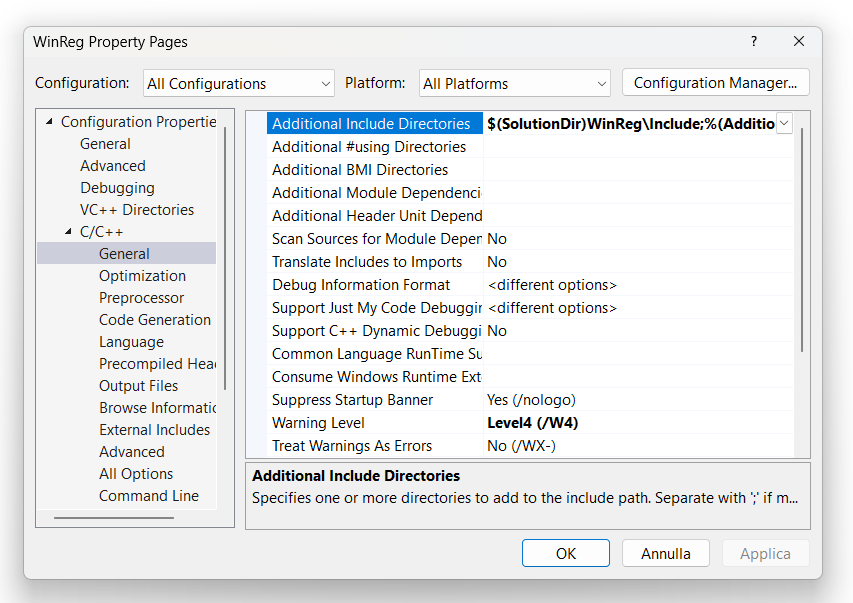

# WinReg v14.0.0 
## High-level C++ Wrapper Around the Low-level Windows Registry C-interface API

by Giovanni Dicanio

The Windows Registry C-interface API is  _very low-level_ and _hard_ to use.

I developed some **C++ wrappers** around this low-level Win32 API, to raise the semantic level, 
using C++ classes like `std::wstring`, `std::vector`, etc. instead of raw C-style buffers and 
low-level mechanisms. 

For example, the `REG_MULTI_SZ` registry type associated to double-NUL-terminated C-style strings 
is handled using a much easier higher-level `vector<wstring>`. My C++ code does the _translation_ 
between high-level C++ STL-based stuff and the low-level Win32 C-interface API.

Moreover, Win32 error codes are translated to C++ exceptions. 
However, note that if you prefer checking return codes, there are also methods that follow 
this pattern (e.g. `TryXxxx()` methods like `TryOpen()`, `TryGetDwordValue()`, `TryGetStringValue()`, 
etc.).

The Win32 registry value types are mapped to C++ higher-level types according the following table:

| Win32 Registry Type  | C++ Type                                                  |
| -------------------- |:---------------------------------------------------------:|
| `REG_DWORD`          | `DWORD`                                                   |
| `REG_QWORD`          | `ULONGLONG`                                               |
| `REG_SZ`             | `std::wstring`                                            |
| `REG_EXPAND_SZ`      | `std::wstring`                                            |
| `REG_MULTI_SZ`       | `std::vector<std::wstring>`                               |
| `REG_BINARY`         | `std::vector<BYTE>`, `std::span<const BYTE>` (input-only) |

This code is currently developed using **Visual Studio 2022**, with **C++20** features 
enabled (`/std:c++20`). The code compiles cleanly at warning level 4 (`/W4`) in 64-bit builds.

This is a **header-only** C++ library (clients should include the main public header **`WinReg/WinReg.hpp`**).

If you use Visual Studio, you can configure the IDE to find the library headers using the standard way:

**Solution Explorer &rarr; right-click the project &rarr; Properties &rarr; Configuration Properties &rarr;
C/C++ &rarr; General &rarr; Additional Include Directories.**

Then click the drop-down next to **Additional Include Directories &rarr; Edit...**

and add the path, for example: `$(SolutionDir)WinReg\Include`

(Note that there is no backslash after `$(SolutionDir)`)




The library exposes four main classes:

* `RegKey`: a tiny efficient wrapper around raw Win32 `HKEY` handles
* `RegException`: an exception class to signal error conditions
* `RegResult`: a tiny wrapper around Windows Registry API `LSTATUS` error codes, 
returned by some `Try` methods (like `RegKey::TryOpen()`)
* `RegExpected<T>`: an object that contains a value of type `T` 
(e.g. a `DWORD` read from the registry) on success, 
or an instance of a `RegResult`-wrapped return code on error

There are many member functions inside the `RegKey` class, that wrap several parts of the native 
C-interface Windows Registry API, in a convenient higher-level C++ way.

For example, you can simply open a registry key and get registry values with C++ code like this:

```c++

#include "WinReg/WinReg.hpp"     // Use Giovanni Dicanio's WinReg library

...

// WinReg's stuff lives in the winreg namespace
using winreg::RegKey;


RegKey  key{ HKEY_CURRENT_USER, L"SOFTWARE\\SomeKey" };

DWORD   dw = key.GetDwordValue (L"SomeDwordValue");
wstring s  = key.GetStringValue(L"SomeStringValue");
```

**NOTE**: If the specified registry key does _not_ exist, a **new** one is _created_ by the constructor.
If you want open-existing-only behavior, consider using the `Open()` or `TryOpen()` methods.

You can also open a registry key using a two-step construction process:

```c++
RegKey key;
key.Open(HKEY_CURRENT_USER, L"SOFTWARE\\SomeKey");
```

The above code will throw an exception on error. If you prefer to check return codes, you can do 
that as well, using a `TryXxxx()` method, e.g.:

```c++
RegKey key;
RegResult result = key.TryOpen(HKEY_CURRENT_USER, L"SOFTWARE\\SomeKey");
if (! result)
{
    //
    // Open failed.
    //
    // You can invoke the RegResult::Code and RegResult::ErrorMessage methods
    // for further details.
    //
    ...
}
```

You can also enumerate all the values under a given key with simple C++ code like this:

```c++
auto values = key.EnumValues();

for (const auto & v : values)
{
    //
    // Process current value:
    //
    //   - v.first  (wstring) is the value name
    //   - v.second (DWORD)   is the value type
    //
    ...
}
```

You can simplify the above iteration code using structured bindings, as well:

```c++
auto values = key.EnumValues();

for (const auto & [valueName, valueType] : values)
{
    //
    // Use valueName and valueType
    //
    ...
}
```

You can also check if a key contains a given value or even a subkey, invoking the
`RegKey::ContainsValue()` and `RegKey::ContainsSubKey()` methods, e.g.:

```c++
if (key.ContainsValue(L"Connie"))
{
    // The key contains the value named "Connie"
    ...
}
```

You can also use the `RegKey::TryGet...Value()` methods, that return `RegExpected<T>` 
instead of throwing an exception on error:

```c++
//
// RegKey::TryGetDwordValue() returns a RegExpected<DWORD>;
// the returned RegExpected contains a DWORD on success, 
// or a RegResult instance on error.
//
// 'res' is a RegExpected<DWORD> in this case:
//
const auto res = key.TryGetDwordValue(L"SomeDwordValue");
if (res.IsValid())  // or simply:  if (res)
{
    //
    // All right: Process the returned value ...
    //
    // Use res.GetValue() to access the stored DWORD.
    //
}
else
{
    //
    // The method has failed: 
    //
    // The returned RegExpected contains a RegResult with an error code.
    // Use res.GetError() to access the RegResult object.
    //
}
```

The library also supports reading raw binary data for Registry types that are unsupported
or less documented (e.g. `REG_RESOURCE_LIST`, `REG_FULL_RESOURCE_DESCRIPTOR`, etc.),
via the `RegKey::GetRawValue()` and `RegKey::TryGetRawValue()` methods.

Note that many methods are available in _two forms_: one that _throws an exception_ of type 
`RegException` on error (e.g. `RegKey::Open()`), and another that _returns an error status object_ 
of type `RegResult` (e.g. `RegKey::TryOpen()`) instead of throwing an exception.
In addition, as indicated above, some methods like the `RegKey::TryGet...Value()` ones return 
`RegExpected` instead of throwing exceptions; in case of errors, the returned `RegExpected` 
contains a `RegResult` storing the error code.

The library stuff lives under the `winreg` namespace.

Thanks to everyone who contributed to this project with some additional features and constructive 
comments and suggestions.

---

## Release Notes for v14.0.0

- The main theme of v14 is **simplification**: I dropped C++17 support, and as a result of that 
  the code got simpler. For example: there are no more preprocessor `#ifdef`s to check whether 
  the code is compiled in C++17 or C++20 mode; C++20 allows simpler default comparison code, 
  `std::in_range()` simplifies the code in `SafeCast.hpp`, etc. 
  Anyway, if you need code that can be compiled in **C++17** mode, you can check 
  the [v12 branch](https://github.com/GiovanniDicanio/WinReg/tree/winreg-v12-cpp20-cpp17-winxp-compatible-and-more-secure-getters).
- `#pragma once` is now used instead of more verbose header guards.
- Note that the code hardening features in getter methods against malformed registry data 
  that were introduced in v12 are still present in this release.
- Note on **Windows XP compatibility**: The code still uses the `RegQueryValueExW()` API, 
  which is compatible with Windows XP; but I'm _not_ promising to focus on Windows XP compatibility 
  (e.g. I may add calls to other APIs that are not available in Windows XP). 
  Moreover, the [latest Visual Studio C++ toolset that supports Windows XP](https://stackoverflow.com/q/69885122) 
  is **v141_xp**, from Visual Studio 2017 (also available in VS 2019). It has full C++14 support, 
  partial C++17 support, but it does _not_ support C++20 (which is required by this release).
  

## Improvements in v12.0.0

- Code can be compiled in both C++17 and C++20 modes.
- The library now uses the `RegQueryValueEx()` API instead of `RegGetValue()`; this makes it
  compatible with "legacy" operating systems, like Windows XP.
- The library is now more robust against malformed registry data. Instead of silently 
  returning wrong or truncated values, the getters now detect these cases and report them
  as errors: for example, a `REG_DWORD` value stored with less than 4 bytes, or UTF-16 strings
  stored with an odd number of bytes (which can't be valid UTF-16).
- `std::move()` is used in more places to enable move semantics and avoid deep-copies.


## Improvements in v10.0.0

- Fixed wrong positions of `[[nodiscard]]` in some places 
  (see e.g. https://giodicanio.com/2026/10/12/where-to-put-nodiscard-a-silent-trap-with-msvc/).
- Furtherly simplified comparison code using new C++20 features.
- Fixed `ConnectRegistry()` and `TryConnectRegistry()`, invoking `Close()` only _after_ 
  the connection is successfully opened.
- `RegTypeToString()` now returns a `const wchar_t*` instead of creating new `wstring` objects
  every time it's invoked (with potential dynamic memory allocations). 
  Moreover, the list of recognized registry types has been extended.
- `SetQwordValue()` and `TrySetQwordValue()` now get the `ULONGLONG` data parameter by value 
  instead of `const&`.
- Get rid of the trailing `'\r\n'` returned by `FormatMessage()` in `RegResult::ErrorMessage()`.
- Add `_ASSERTE(IsValid())` in places like `QueryReflectionKey()` and similar reflection methods
  where it was missing.
- Added a safety check in `ScopedLocalFree::AddressOf()` to free any allocated memory 
  _before_ returning write access to the pointer member.
- Simplified the `InfoKey` structure code using member initialization.
- Simplified code using C++20's `std::in_range()` instead of custom code in `SafeCast.hpp`.
- Improved parsing behavior of double-NUL-terminated strings, including some edge cases.
- Improved `RegKey`'s methods `ContainsSubKey()` and `TryContainsSubKey()`.


## Improvements in v8.0.0

- Moved the codebase to C++20 (this is the first release targeting C++20).
- Added `std::span<const BYTE>` overloads for some `RegKey` methods, like `SetBinaryValue()` and `TrySetBinaryValue()`.
- Used "spaceship operator" for comparing `RegKey` objects instead of previous "classic" relational operator overloads.

